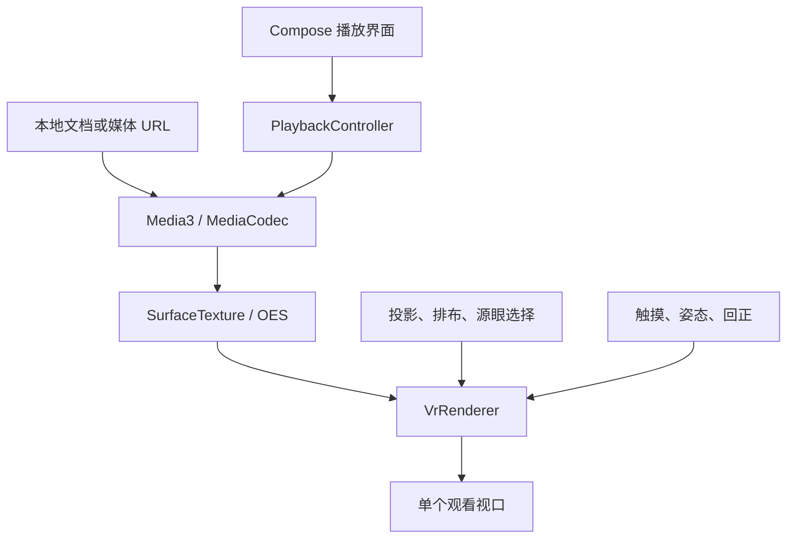

# VRviewer：设计依据、完整改进方向与验收路线

研究基线日期：2026-10-23，Asia/Shanghai。最新产品约束（2026-10-24）：首页只保留“打开本地文件”“打开 URL 链接”；用户明确删除显示方式和双眼分屏。当前修改基线为 main@7cadebad8beb05f5b9f36c444fe5f44d18d9933f。目标仓库：`Grinch27/VRviewer`。同日新增决定：工作流参考 awara，仅构建并上传 APK，不运行测试环节；本文件保留的测试矩阵属于历史证据与按需手动诊断。

## 1. 已确认事实与研究边界

| 对象 | 核验基线 | 发现 |
| --- | --- | --- |
| VRviewer | `main@9a7f089687949787d3b9b4d5473cd90f5b994317` | 初始只有 `AGENTS.md`、GPL v3 `LICENSE`；没有待修复的旧播放器 |
| awara main | `7e84d9b7e411fd690bd74909c1e6fb8bf7b7823e` | Kotlin/Compose；存在 `app`、`core:model`、`data`、`feature:player`、`feature:search` 与 build-logic；播放器仍是 ExoPlayer 2.18.6 |
| awara dev | `81a26ad52d7f33340ff0f0a29e1a9126b0c42453` | 播放器迁移到 Media3，网络和播放仍有关联；部分依赖使用动态 `+`，不能把版本解析结果当成固定基线 |
| EhViewer | `master@9e1021640472ee45f35c0bb1950723db08549b9e` | Kotlin/Java、Views、单 app 模块，含图库 Provider、UniFile、GL 图片显示、Room、原生图片/归档处理；它是图片阅读器 |

已完整取得三个仓库文件树，并重点审阅播放器状态与视图、视频详情/ViewModel、文件访问、图库 Provider、GL 生命周期、构建配置和工作流。参考项目未在本轮完整构建运行，也不把取得全部源码等同于逐行完成安全审计。

本轮用户明确授权设计、改进并部署到 VRviewer。awara、EhViewer 仅作只读参考。没有使用它们的账号、私有数据、签名密钥或线上服务。

## 2. 产品终态与暂定假设

首要终态：通过两个首页按钮打开本地视频或 HTTP/HTTPS 媒体直链，在一个观看窗口内正确解码、选取源画面、投影并控制视角与播放进度。

已确认产品决定：删除“显示方式（单眼窗口/双眼分屏）”、双视口、镜像控制栏和播放器方向请求；屏幕方向遵循系统设置。SBS/TB 是片源排布，保留左/上与右/下源画面的选择。旧历史的 display 字段不再读取，进度和其他设置继续保留。

暂定假设与未知：

- 片源是普通平面视频或已拼接的等距柱状 180°/360°；常用编码、码率、分辨率与投影元数据仍未知。
- 基线 Android 8.0 / API 26；实体手机、传感器、不同存储提供方与长时间温升仍需验收。
- SDR 先建立正确基线，HDR 色调映射需要独立验证。

范围内：两个入口、本地文档与 HTTP/HTTPS 媒体直链（progressive/HLS/DASH）、单窗口投影、源眼选择、进度、逐文件设置、错误恢复、构建和回归验证。

范围外：显示模式切换、双眼分屏、方向锁定、头显光学后端、视频网站 HTML 解析、账号、推荐、下载器、投屏、云同步、编辑、图片阅读、社交和广告。已删除的功能不得自动重新引入。

## 3. 当前模式与方向策略

投影和片源排布保持独立，输出固定为一个视口，不提供显示方式选项。

| 配置 | 选项 | 决定什么 |
| --- | --- | --- |
| Projection | 平面 / 等距柱状 180° / 等距柱状 360° | 从屏幕射线到视频的空间映射 |
| StereoLayout | 单目 / 左右 SBS / 上下 TB | 源视频中画面的排布 |
| 源眼选择 | 默认左/上，可选右/下 | 当前窗口取样哪一幅源画面；单目使用整帧 |

平面立体片源继续区分 full packing 和 half packing，恢复正确宽高比。180°背面输出黑色，360°覆盖完整经纬范围。手动设置优先于未来的识别建议。

用户报告旧显示方式会让手机反复横竖切换直到卡死。源码确认原 PlaybackScreen 在 DisposableEffect 中请求方向，销毁时恢复旧方向；配置重建后可能重复进入该路径。此为与报告一致的风险路径，尚未在用户原设备独立复现。

本轮处理为彻底删除方向请求与恢复逻辑，不用 Manifest 锁方向或 configChanges 绕过重建。自动回归检查设置中不存在旧选项、播放器不改变宿主请求方向，并在两次 Activity 重建后继续恢复投影与片源设置。最终成功仍需用户原设备复测。

## 4. 从两个参考项目吸收什么

| 参考位置/思路 | 可吸收的价值 | VRviewer 的处理 |
| --- | --- | --- |
| awara `feature/player/PlayerBase.kt` | 播放视图与上层业务分离 | `VrVideoView` 只负责 Surface、渲染、输入；不做文件选择和历史存储 |
| awara `PlayerState.kt` | 用可观察状态驱动 UI、释放监听与播放器 | 独立 `PlaybackController`，明确前台/后台和 Surface 生命周期 |
| awara dev Media3 迁移 | 采用维护中的 Android 播放组件 | 从首版使用 Media3，不增加旧 ExoPlayer 兼容层 |
| awara `PlayerScaffold.kt` | 全屏系统栏管理 | 播放页管理并恢复系统栏，避免全屏状态泄漏到文件首页 |
| awara Compose/Material 3 | 声明式 UI 与主题 | 保留 Material 3，使用紧凑、清晰的功能布局 |
| awara ViewModel/Repository 边界 | 数据与界面解耦 | Controller/Store 分层；轻量 PlaybackSession ViewModel 保留旋转时的当前源状态，不持有 Activity/播放器 |
| awara 历史/数据库 | 续播与本地播放记录 | 首版仅存 50 条 URI、名称、进度和模式，不复制媒体 |
| awara 模块化 | 防止所有业务进入 Activity | 先拆纯 JVM `core` 与 Android `app`，app 内再分 playback/render/storage/ui |
| awara build-logic | 大项目的共享构建约定 | 两模块阶段使用版本目录和简洁脚本，不提前搬入整套 convention 插件 |
| EhViewer 高信息密度 | 播放器内减少跳转，选项集中 | 常用模式集中在播放器设置面板；按最新要求不迁移图库首页，首页严格两个按钮 |
| EhViewer `GalleryProvider2`/`ArchiveGalleryProvider` | 数据提供与显示分离、可取消的 I/O、资源关闭 | 元信息读取放 I/O 调度器，解码和 GL 各自负责对应资源 |
| EhViewer `UniFile`/`Contracts` | URI 与文件描述符抽象 | 使用原生 SAF `content://`；不把 URI 强行转成路径，不搬入完整 UniFile |
| EhViewer `GalleryActivity` | 手势、全屏、遥控/键盘、进度面板 | 用于播放交互设计；避免把播放器、传感器和存储堆成巨型 Activity |
| EhViewer GL 生命周期 | 暂停/恢复与纹理资源管理 | 单独 GL 线程，Surface 交接在主线程；最终释放前停止 GL |
| EhViewer 版本目录、格式/构建检查 | 版本集中与可检查的产物 | 固定依赖、Wrapper 校验和两个 APK 变体；历史像素测试保留源码，当前 CI 仅构建 |

不迁移：网站 API、账号 Cookie、DoH、下载与磁盘网络缓存、论坛/评论、图库原生解码、归档处理、现成签名文件、业务品牌及应用 ID。它们没有解决本地 VR 播放的关键问题。

也不照搬参考项目的动态依赖、旧 target SDK、现成工作流权限或历史巨型类结构。项目目标与真实接口决定实现。

## 5. 播放与渲染架构

- Media3 负责解封装、音视频同步、音频焦点、平台解码、seek 和播放速度。
- 一个解码器输出一份 OES 纹理；按片源排布裁剪所选源画面，只绘制一个视口。
- GL 依据整个观看视口的宽高比构造观察射线，再按平面或等距柱状公式取样。
- 先按逻辑视频的左上原点裁剪眼睛，再转换纹理坐标并应用 SurfaceTexture 矩阵；不能交换顺序。
- 源画面在边缘使用半 texel 边界限制，避免线性过滤采到另一眼的像素。
- 传感器仅在前台且用户启用时注册；优先 game rotation vector，缺少时回退 rotation vector，再缺少则使用触摸。
- SBS/TB 只选取其中一幅画面；当前没有双视口和立体头显输出。
- Shader 实现简单正投影取样，不支持源视频附带的任意网格、相机运动元数据或鱼眼重映射。

### 渲染方案取舍

| 方案 | 适用条件 | 优点 | 限制 / 结论 |
| --- | --- | --- | --- |
| Media3 `SphericalGLSurfaceView` | 快速做单窗口全景预览 | 现成触摸/姿态/球面支持 | 可用于单窗口预览；替换后端仍需单独验证现有片源裁剪与输入交互 |
| Media3 + 小型自定义 GL | 当前单窗口、本地等距柱状播放 | 一个解码器、模式明确、无 NDK、核心公式可独立测试 | 需承担坐标、Surface、设备 GPU 验证；当前首版采用 |
| Media3 + Cardboard SDK | 确定手机头显、需要镜片参数和预测姿态 | 官方提供头部追踪、眼矩阵、畸变渲染与查看器参数 | 当前范围外；只有重新明确授权头显功能后才研究 NDK/JNI、ABI 与光学验收 |
| Unity 等完整引擎 | 后续变成三维场景应用 | 3D 场景和 XR 工具成熟 | 对专用本地播放器增加包体、启动和维护成本；当前不选 |

Cardboard 仅保留为技术参考；当前不实现头显后端，也不以任何方式恢复已删除的分屏功能。

## 6. 首版落地与完整改进清单

“已实现”表示源码存在；是否通过构建、模拟器、手机测试，必须再看 README 的实际验证记录。

| 优先级 | 改进点 | 目的与边界 | 首版状态 / 后续验收 |
| --- | --- | --- | --- |
| P0 | SAF 和外部打开入口 | 不索取全盘权限，正确处理临时/持久授权 | 已实现；补不同文件管理器、SD 卡和撤权实机测试 |
| P0 | I/O 边界 | 本地文档与指定 HTTP/HTTPS 直链，拒绝其他协议和任意 file 路径 | 已实现；URL 纯解析、协议拒绝和回环 HTTP 像素播放测试 |
| P0 | 投影与排布独立 | 固定一视口，正确区分空间投影与视频排布 | 已实现；三种投影 × 三种排布及源眼选择 |
| P0 | 平面比例恢复 | 全宽/半宽 SBS 与全高/半高 TB 不被拉伸 | 已实现；JVM 比例测试与后续测试卡实测 |
| P0 | 单解码单视口 | 移除分屏与重复控制，正确裁剪一幅源画面 | 已实现；红/蓝像素测试检查所选画面覆盖观看窗口 |
| P0 | 180°/360°射线投影 | 不把半球当全球，不倒置上下 | 已实现；JVM 地标测试；接缝/极点/旋转需图卡与手机验收 |
| P0 | 生命周期和 Surface | 不出现退出仍发声、切换后黑屏或泄漏 | 已实现；补后台/前台、锁屏、旋转、EGL 丢失长循环 |
| P0 | 音频焦点和 noisy | 来电/其他音频和耳机断开时行为合理 | 使用 Media3；蓝牙、拔耳机和来电要实机验证 |
| P0 | SDR 边界 | 避免 HDR 被错误色彩显示 | 检测 HDR 后暂停；HDR 色调映射单独研究 |
| P0 | 可理解错误与重试 | 文件失效、格式不支持、解码和 GL 错误能恢复 | 已实现；错误不包含完整文件 URI 或视频原文 |
| P0 | 可持续构建 | 全新克隆可生成 APK | Wrapper、版本目录、Non-container CI 与 SHA256；当前 CI 仅打包并上传 Debug/未签名 Release |
| Out | 真实光学 VR | 镜片畸变、瞳距/眼矩阵、头显参数 | 用户当前删除分屏；重新授权前不恢复此方向 |
| P1 | 姿态正确性与舒适度 | 控制横竖屏、方向、roll、漂移、回正与延迟 | 首版可选基础姿态；未测预测，需两种手机姿态与传感器缺失路径 |
| Out | 头显内操作 | 镜像菜单、凝视与立体传输控制 | 重复控制栏已删除；普通播放按键与回正保留 |
| P1 | 音轨与字幕 | 真正完整的视频播放器能力 | 未实现；先做音轨选择与本地 SRT/WebVTT，在单个观看窗口内保持可读 |
| Out | 首页媒体库和目录扫描 | 最新要求首页仅两个按钮 | 不增加媒体库/最近列表；内部最多保留 50 条本地进度，是否扩展需新需求 |
| P1 | 片源识别与纠错 | 识别投影/排布但允许手工覆盖 | 未实现；优先可信容器元数据，再给文件名建议；绝不只按宽高强制识别 |
| P1 | 完整逐文件记忆 | 本地进度与模式；网络 URL 仅当前会话 | 已有本地 URI 级记忆；URL 用 ViewModel 保留旋转状态，进程结束后从头开始；后续清理失效记录并释放淘汰的持久 URI 授权，控制系统授权配额 |
| P1 | 网络直链质量 | 完成新增 URL 入口的真实片源验收 | 回环 HTTP MP4 已有像素测试；真实 HTTPS、HLS/DASH、Range/重定向、无后缀 MIME、不可 seek 的直播、断网与过期链接仍需验收；保持直链与会话存储边界 |
| P1 | 详细解码诊断 | 容器与编码、profile、分辨率、码率分开判断 | 先提供用户可读失败；后续本机诊断页和明确测试矩阵，默认不外发 |
| P1 | 性能与温升 | 选择实际能稳播的分辨率/帧率 | 当前无 CPU 帧拷贝；4K/8K、HEVC/AV1、掉帧、温升和功耗均待测 |
| P1 | 无障碍与适配 | 字号、触摸目标、TalkBack、横屏/平板 | 原生按钮与视频点击入口；仍需大字号、窄分屏和各类外设验收 |
| P1 | 稳定分发 | 独立正式签名、版本与可更新安装 | 当前只交付调试预览；Release 保持未签名，不复制参考项目密钥 |
| P2 | HDR 正确渲染 | 10 bit、色域、transfer、色调映射和系统显示链完整验证 | 未实现；必须有 HDR 测试卡和 SDR 对照，不能只删掉限制 |
| P2 | 更多投影 | 双鱼眼、立方体、任意网格与投影元数据 | 未实现；每种独立定义输入、映射和金标准，不扩大“180°”标签含义 |
| P2 | PiP/后台与系统媒体控制 | 只在明确有需求时加入 | 当前离开前台停止；MediaSession/前台服务会改变权限与资源边界 |
| Out | 网络平台、社交、下载、投屏 | 当前不服务于本地 VR 核心路径 | 不纳入首版，也不默认迁移参考项目对应代码 |

P0 是首版正确性和可构建性；P1 是专用播放器完善与实机体验；P2 需要新增能力和明确设备证据。P1/P2 不能描述为已完成。

## 7. 可测验收矩阵

### 历史覆盖与按需手动诊断（当前 CI 不执行）

| 检查 | 方法 | 客观预期 |
| --- | --- | --- |
| 每眼裁剪 | JVM + 红/蓝 H.264 instrumentation | 左右、上下源眼选择时只出现所选画面的颜色 |
| 全球地标 | 纯 JVM 球面公式 | 前方中心、右侧 3/4、顶部 v=0；180°后方无采样 |
| 比例与异常设置 | JVM | full/half packing 与像素宽高比正确；非法 FOV 回退并限制范围 |
| 播放终点记忆 | JVM | 接近结尾重新从头播放，负位置归零，未知时长不越界 |
| 来源边界与 URL | JVM + instrumentation | 拒绝 data/ftp 与任意系统 file；保留签名参数；回环 HTTP 可解码、选眼并 seek |
| 历史存储 | instrumentation | 模式、源眼和进度保持；旧 display 字段忽略并在下次保存时移除 |
| 实际渲染 | emulator PixelCopy | MediaCodec 到 GL 的颜色正确；一个视口正确显示所选源眼，平面/180°/360°切换保持裁剪正确 |
| 方向回归 | 实际播放器设置 + Activity 重建 | 无显示选项、不覆盖宿主方向，两次重建后设置仍在 |
| 当前构建 | Gradle/R8 | 仅 assembleDebug/assembleRelease 与 APK/SHA256 产物；不构建测试 APK |

单元测试不能替代 GPU；像素测试不能替代光学舒适度；模拟器不能替代手机硬件编解码和温升。

### 手机验收（尚未执行）

1. 至少两台不同 GPU/SoC 手机，覆盖 Android 8–11 与较新系统；列出实际设备，不虚构覆盖率。
2. H.264 SDR MP4 基准，再分别增加 MKV、HEVC、AV1、不同音频与高分辨率；每种记录容器、编码、profile、位深、帧率、分辨率、码率和结果。
3. 三种投影 × 三种排布，包含左右/上下源眼选择；使用方向/网格/文字图卡检查左右、上下、比例、接缝和 180°背面。
4. 横竖屏、左右横屏、触摸与传感器切换、pitch/roll、回正和缺少传感器；确认关闭后不再注册传感器。
5. 后台/前台、锁屏、旋转、应用重建、短暂停、音频焦点、耳机/蓝牙断开；连续循环，检查静音、位置和资源释放。
6. SD 卡断开、文件移动、撤销授权、只给临时权限、提供方异常、损坏视频与不支持编码；界面能恢复且不出现错误续播。
7. 至少 30 分钟视频基准，记录丢帧、音画同步、温升、CPU/GPU、内存与电量；不以一次短片播放代替稳定性验证。
8. 在用户报告问题的原设备反复进入播放器、打开设置、返回及旋转，确认无自动方向循环；保留系统自动旋转设置。

## 8. 工程与失败路径

- 当前 `app` 负责 Android/Media3/GL，`core` 不依赖 Android，可在 JVM 直接测试。尚无服务端或生产基础设施。
- 不在 UI 主线程扫描目录或复制大视频；当前只查询名称，放在 I/O 调度器。后续缩略图必须有并发与缓存预算。
- 历史上限 50；若扩展成大型库，应迁移 Room 并提供迁移测试，不在 SharedPreferences 里无限累积列表。
- 先保留新建项目的两模块结构，重复出现后再抽 convention 插件；避免为“架构完整”堆出空模块。
- 播放器主线程调用；GL 线程消费纹理；Surface 发布/替换在主线程；先解绑播放器再释放 Surface。
- Surface/EGL 重建应替换纹理并重新连接，不能把已 release 的 Surface 留给解码器。
- 播放器不拥有屏幕方向：不请求方向，也不在销毁时恢复方向；旧历史 display 字段忽略，旧 swap 只迁移为源眼选择。
- 不保存视频副本、不创建视频日志、不外发完整 URI；本地进度记录保留 content URI。网络 URL 不写永久历史，在当前会话内保留；配置和历史关闭备份与设备迁移。
- 网络播放按用户指定地址发起，首页无自动预取。HTTPS 使用系统证书；允许局域网常见的 HTTP，HTTP 本身不加密。链接中的用户名/密码不接受，签名查询参数保留，不额外解析网页或配置鉴权头。
- 构建使用官方下载，依赖固定版本；远程 Action 依仓库规范跟随 main，因此其内容仍会变化，不能声称整个 CI 完全不可变。
- 首次本地 AAR 检查证实 Compose BOM 2026.09.00 要求 SDK 37/AGP 9.1；为保留 SDK 36/AGP 8.13 基础路线，改用官方 BOM 2026.03.00（Compose UI 1.10.5 / Material 3 1.4.0）。已读取 UI AAR 元数据，其最低 compile SDK 35、AGP 8.6；完整兼容性仍由构建验证。
- 当前调试 APK 与未签名 Release 各有用途，不能把未签名 APK 描述为可直接安装成品，也不把调试签名当正式密钥方案。

## 9. 风险与授权边界

| 等级 | 风险 | 处理 |
| --- | --- | --- |
| HIGH | 方向请求与销毁恢复形成重建循环 | 显示模式及所有播放器方向写入已删除；模拟器回归后仍需原设备复测 |
| HIGH | HDR 经普通 8 bit GL 链路显示错误 | 目前显式暂停；色调映射通过测试后再开放 |
| MEDIUM | 坐标、眼睛、姿态或 Surface 生命周期错误 | 数学与像素测试加设备循环；手机实测前不认定稳定 |
| MEDIUM | 大分辨率编码超过芯片能力、温升或掉帧 | 实测矩阵、降级提示、性能记录；不承诺 8K |
| MEDIUM | URI 授权失效或私有历史被备份 | 持久授权尝试、重新选片、关闭备份与传输 |
| MEDIUM | main 分支 Action 随上游变化 | 引入时核验入口与分支；CI 变化后重新验证 |
| LOW | 首页简洁，扩展能力有限 | 保持两个按钮；优先完善播放器内音轨、字幕与交互 |

本轮用户要求仅构建工作流，授权相应工作流、文档、冗余 CI 模拟器脚本清理与 main 提交；由提交触发 APK 构建，不执行测试。

未授权且不执行：修改两个参考仓库、修改许可证、复制/上传用户视频、安装到用户手机、修改设备设置、生产签名密钥、商店发布、收费服务或新增网络平台功能。停止条件是遇到这些边界，或无法证明写入基于目标分支最新内容。

## 10. 后续执行顺序与成功定义

1. 按用户最新要求，仅构建 Debug/未签名 Release 并上传 APK/SHA256；不在工作流恢复测试环节，历史证据保持对应原提交。
2. 在用户原设备复测方向循环消失，并收集型号、系统版本及典型片源参数。
3. 保持两个按钮首页与单观看窗口，优先完善音轨、字幕、手势和真实网络片源验收。
4. 完成稳定签名与安装更新策略，再讨论正式版本分发。
5. 只有设备证据证明有收益和需求时，增加 HDR、更多投影或软件解码扩展。

首版成功定义：全新克隆能够构建，调试 APK 可安装；本地文件、投影/排布、源眼选择、方向稳定性和基本播放链有可核验证据；剩余实机限制明确列出。

成熟版本成功定义：目标手机上的真实片源正确播放与切换，前后台/失效权限/解码失败能恢复，长时间观看的帧率、音画同步和温升达到已确定的验收标准。当前尚不能认定达到成熟版本标准。

## 11. 一手技术依据

- [Media3 ExoPlayer 入门与自定义 Surface](https://developer.android.com/media/media3/exoplayer/hello-world)
- [Media3 支持格式与设备解码限制](https://developer.android.com/media/media3/exoplayer/supported-formats)
- [Media3 版本记录](https://developer.android.com/jetpack/androidx/releases/media3)
- [Android SAF 文档与持久访问](https://developer.android.com/training/data-storage/shared/documents-files)
- [Android SurfaceTexture](https://developer.android.com/reference/android/graphics/SurfaceTexture)
- [SensorManager 坐标系](https://developer.android.com/reference/android/hardware/SensorManager)
- [Google Cardboard Android NDK 指南](https://developers.google.com/cardboard/develop/c/quickstart)
- [Kotlin/Gradle/AGP 兼容范围](https://kotlinlang.org/docs/gradle-configure-project.html)
- [Compose BOM](https://developer.android.com/develop/ui/compose/bom)
- [GitHub Actions 工作流语法](https://docs.github.com/zh/actions/reference/workflows-and-actions/workflow-syntax)

方向与重建依据：[Compose Side-effects](https://developer.android.com/develop/ui/compose/side-effects)、[Handle configuration changes](https://developer.android.com/guide/topics/resources/runtime-changes)。
